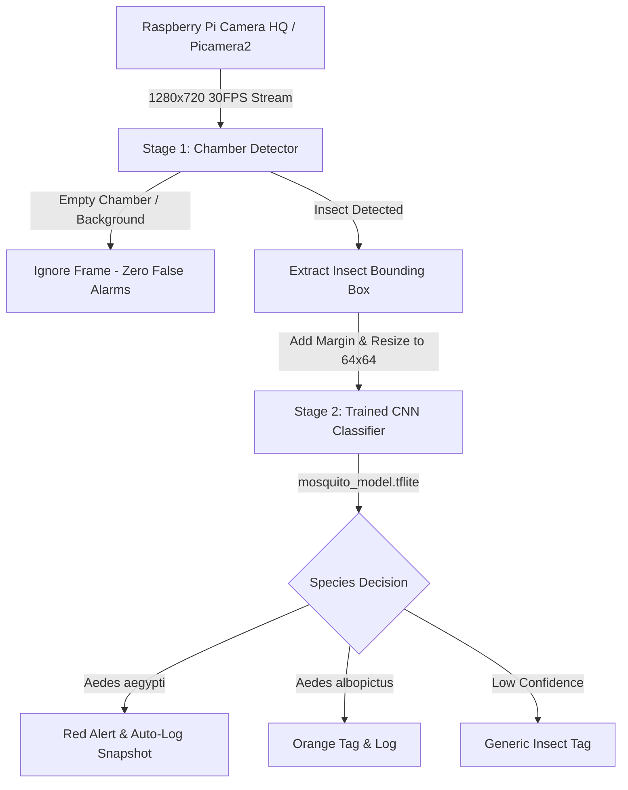

# Real-Time Chamber Mosquito Detector (Two-Stage Pipeline)

A real-time *Aedes aegypti* and *Aedes albopictus* monitoring and detection system designed for a controlled chamber environment with a white background using the **Raspberry Pi Camera HQ** and your trained CNN classifier.

---

## 🌟 System Architecture: Two-Stage Pipeline

Traditional classifiers fail in open spaces because they are mathematically forced to guess a mosquito even on empty walls. This project solves that problem with an industrial **Two-Stage Pipeline**:



1. **Stage 1 (Object / Insect Detection)**:
   - Detects when an insect is physically present in the white chamber.
   - Supports two detection engines:
     - **YOLOv8** (`yolov8n.pt`): Deep-learning bounding box detection.
     - **Chamber Contrast Detector**: Ultra-fast adaptive thresholding optimized for dark mosquito bodies on clean white chamber surfaces (runs at 40+ FPS on Raspberry Pi CPU).
   - If no insect is in the chamber, the system remains idle without false alarms.

2. **Stage 2 (Species Classification)**:
   - Once an insect is localized, its bounding box is cropped, padded, resized to 64x64, and normalized.
   - Fed into your pre-trained [`models/mosquito_model.tflite`](models/mosquito_model.tflite) to distinguish **Aedes aegypti** from **Aedes albopictus**.

---

## 📁 Project Structure

```text
Chamber_Mosquito_Detector/
|-- models/
|   |-- mosquito_model.tflite   (Trained 64x64 CNN model - Edge optimized)
|   `-- mosquito_model.pkl      (Trained Keras architecture + weights)
|-- captures/                   (Auto-saved alert snapshots with timestamp)
|-- detection_log.csv           (CSV log of all verified detections)
|-- chamber_detector.py         (Main real-time detection & inference pipeline)
|-- config.py                   (Camera, threshold, and logging configuration)
|-- requirements.txt            (Dependencies)
`-- README.md                   (Documentation & Hardware Setup Guide)
```

---

## 🔬 Hardware & Chamber Setup Guidelines

### 1. Raspberry Pi Camera HQ (Sony IMX477 12.3MP)
- **Lens**: A 6mm wide-angle or 16mm telephoto C/CS mount lens.
- **Macro Focus Adjustment**: 
  - To focus on a mosquito from 5–15 cm distance, rotate the front focus ring counter-clockwise until the tiny insect is pin-sharp.
  - If using a standard C-mount lens, ensure the included 5mm C-CS adapter ring is installed.

### 2. White Chamber Illumination
- Line the chamber walls with matte white acrylic, foam board, or non-reflective white paper.
- Use a **diffused LED ring light** or soft LED strip around the lens or chamber ceiling.
- Diffuse lighting eliminates harsh shadows that could distort the insect's outline.

---

## 🚀 Installation & Running

### On Raspberry Pi (Raspberry Pi OS 64-bit Bookworm / Bullseye)

1. Open terminal and update packages:
   ```bash
   sudo apt update && sudo apt install -y python3-picamera2 python3-opencv python3-numpy
   ```

2. Install lightweight TFLite runtime and Ultralytics:
   ```bash
   pip3 install tflite-runtime ultralytics
   ```

3. Launch the detector:
   ```bash
   python3 chamber_detector.py
   ```

### On Windows / PC (Testing with Webcam, USB Camera, or Video File)

1. Open PowerShell / Command Prompt and navigate to this directory:
   ```powershell
   cd "c:\Users\LAPTOP\OneDrive\ドキュメント\agent skill\Chamber_Mosquito_Detector"
   ```

2. Run with standard Python (auto-detects webcam):
   ```powershell
   python chamber_detector.py
   ```

3. **Optional Flags**:
   - Run on a specific webcam (e.g., webcam 0 or external USB camera 1):
     ```powershell
     python chamber_detector.py --source 0
     ```
   - Run on a recorded video file:
     ```powershell
     python chamber_detector.py --source "path/to/mosquito_test.mp4"
     ```
   - Force ultra-fast white-chamber contrast mode instead of YOLO:
     ```powershell
     python chamber_detector.py --mode chamber_contrast
     ```

---

## ⌨️ Live Keyboard Controls

| Key | Action |
| :---: | :--- |
| `Q` / `ESC` | Cleanly exit and release camera |
| `S` | Manually capture and save high-resolution snapshot |
| `M` | Toggle detection engine between **YOLO** and **Chamber Contrast** mode |

---

## ⚙️ Configuration (`config.py`)

You can customize camera settings and thresholds in [config.py](config.py):
- `FRAME_WIDTH`, `FRAME_HEIGHT`: Set resolution (e.g. `1280x720` for high FPS or `1920x1080` for maximum clarity).
- `CLASSIFICATION_THRESHOLD`: Confidence required to declare *Aedes aegypti* (default: `0.80` / 80%).
- `AUTO_SAVE_SNAPSHOT`: Automatically saves photos of detected *Aedes aegypti* into `captures/`.
