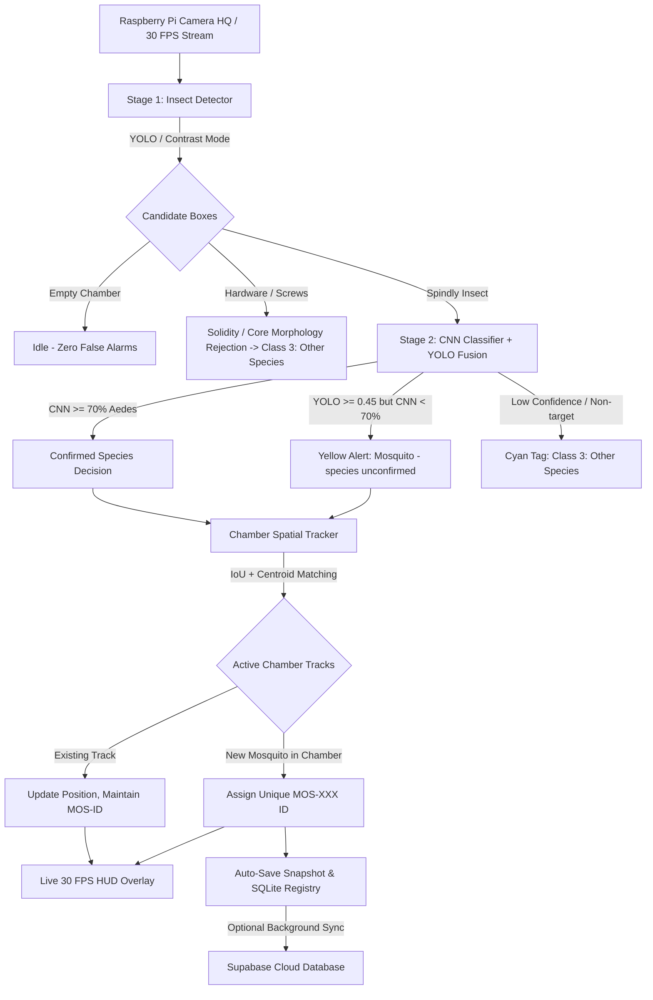

# Real-Time Chamber Mosquito Detector (Two-Stage Pipeline & Spatial ID Tracking)

A real-time *Aedes aegypti* and *Aedes albopictus* monitoring, classification, and unique ID tracking system designed for controlled chamber environments with a white background using the **Raspberry Pi Camera HQ** (Sony IMX477), YOLO insect localization, Stage 2 CNN classification, and a sub-millisecond multi-object spatial tracker.

---

## 🌟 System Architecture

Traditional classifiers fail in open spaces because they are mathematically forced to predict a class even on empty walls. This project implements an industrial **Two-Stage Pipeline** with hardware rejection, decision fusion, and spatial re-identification:



1. **Stage 1 (Insect Detection & Localization)**:
   - **YOLO Mode**: Deep learning bounding box detector native to small insects.
   - **Chamber Contrast Mode**: Ultra-fast adaptive thresholding optimized for dark mosquito bodies on clean white chamber surfaces (runs at 40+ FPS on Raspberry Pi CPU).
   - **Chamber ROI**: Configurable edge margins (`ROI_MARGIN_X`, `ROI_MARGIN_Y`) isolate the chamber floor and exclude silicone glue seams and acrylic wall joints.

2. **Morphological Check (Hardware vs Spindly Insects)**:
   - Screws, bolts, and dense metal have high solidity ($> 0.68$) and dense core retention ($> 0.32$).
   - True mosquitoes with spindly legs and slender abdomens have low solidity ($< 0.68$) and low core retention ($< 0.32$). Dense hardware is immediately filtered as `Other Species` without false alarms.

3. **Stage 2 (Species Classification & Decision Fusion)**:
   - Aspect-preserved square crops are fed to the CNN model to distinguish **Aedes aegypti** (Red, Class 1) from **Aedes albopictus** (Orange, Class 2).
   - If YOLO detects an insect but CNN confidence is borderline ($< 70\%$), it is labeled **Mosquito - species unconfirmed** (Yellow) rather than misclassifying.

4. **Multi-Mosquito Chamber Spatial Tracking (`mosquito_tracker.py`)**:
   - Pure Python/NumPy spatial tracker using bipartite **IoU and centroid distance matching**.
   - **Simultaneous Co-occurrence Guarantee**: Multiple mosquitoes visible at the same time in the chamber are guaranteed to receive **distinct, unique IDs** (`MOS-001`, `MOS-002`, `MOS-003`).
   - **Persistent On-Screen Display**: MOS IDs remain locked onto moving mosquitoes at 30 FPS.
   - **Rate-Limited Logging**: Avoids log flooding; new mosquitoes log immediately, while resting insects update SQLite in-memory and write to CSV only periodically.

---

## 📁 Project Structure

```text
Chamber_Mosquito_Detector/
|-- models/
|   |-- mosquito_model.tflite   (Trained 64x64 CNN model - Edge optimized)
|   |-- mosquito_model.onnx     (Universal ONNX runtime model)
|   |-- mosquito_model.pkl      (Trained Keras architecture + weights)
|   `-- mosquito_yolo11.pt      (Trained YOLO insect detector)
|-- captures/                   (Auto-saved alert snapshots with timestamp)
|-- detection_log.csv           (CSV log of detections and tracking history)
|-- mosquito_registry.db        (SQLite database storing unique mosquito records)
|-- chamber_detector.py         (Main real-time detection & inference pipeline)
|-- mosquito_tracker.py         (Chamber spatial tracking & SQLite registry manager)
|-- view_db.py                  (Terminal database viewer and summary tool)
|-- config.py                   (Camera, threshold, tracking, and cloud configuration)
|-- requirements.txt            (Dependencies)
`-- README.md                   (Documentation & Hardware Setup Guide)
```

---

## 🔬 Hardware & Chamber Setup

### 1. Raspberry Pi Camera HQ (Sony IMX477 12.3MP)
- **Lens**: 6mm wide-angle or 16mm telephoto C/CS mount lens.
- **Macro Focus**: Rotate the front focus ring counter-clockwise until the tiny insect is pin-sharp at 5–15 cm.
- Ensure the included 5mm C-CS adapter ring is installed when using standard C-mount lenses.

### 2. Chamber Illumination
- Line the chamber walls with matte white acrylic, foam board, or non-reflective white paper.
- Use a **diffused LED ring light** or soft LED strip around the lens or chamber ceiling to eliminate harsh shadows.

---

## 🚀 Installation & Running

### On Raspberry Pi (Bookworm / Trixie / Bullseye)

1. Install system camera and vision packages:
   ```bash
   sudo apt update && sudo apt install -y python3-picamera2 python3-opencv python3-numpy sqlite3
   ```

2. Activate or create your virtual environment:
   ```bash
   python3 -m venv --system-site-packages env
   source env/bin/activate
   ```

3. Install runtime dependencies:
   ```bash
   pip install ai-edge-litert ultralytics
   # OR for ONNX: pip install onnxruntime ultralytics
   ```

4. Launch the detector:
   ```bash
   python3 chamber_detector.py
   ```

---

### On Windows / PC (Testing with Webcam, USB Camera, or Video)

1. Open PowerShell / Command Prompt in the repository folder:
   ```powershell
   cd Chamber_Mosquito_Detector
   ```

2. Run with standard Python (auto-detects webcam):
   ```powershell
   python chamber_detector.py
   ```

3. **Optional Arguments**:
   - Run on external USB camera:
     ```powershell
     python chamber_detector.py --source 1
     ```
   - Run on recorded video file:
     ```powershell
     python chamber_detector.py --source "path/to/test_video.mp4"
     ```
   - Run with explicit detection mode:
     ```powershell
     python chamber_detector.py --mode yolo
     python chamber_detector.py --mode chamber_contrast
     ```

---

## 📊 Viewing the Database in Terminal

To inspect the SQLite mosquito registry directly in your terminal:

```bash
python3 view_db.py
```

Output displays a formatted table of all registered mosquitoes:
```text
===================================================================================================================
MOS ID     SPECIES              CONF     COUNT   STATUS         PREDICTION           LAST SEEN
===================================================================================================================
MOS-001    Aedes aegypti        92.5%    14      unverified     Aedes aegypti        2026-10-23 21:56:44
MOS-002    Aedes aegypti        89.0%    8       unverified     Aedes aegypti        2026-10-23 21:56:44
MOS-003    Aedes albopictus     94.2%    11      unverified     Aedes albopictus     2026-10-23 21:56:44
===================================================================================================================
Total: 3 registered mosquito(es)
```

Alternatively, you can open an interactive SQL shell:
```bash
sqlite3 mosquito_registry.db
```

---

## ⌨️ Live Keyboard Controls

| Key | Action |
| :---: | :--- |
| `Q` / `ESC` | Cleanly exit, flush database updates, and release camera |
| `S` | Manually capture and save high-resolution snapshot |
| `M` | Toggle detection engine between **YOLO** and **Chamber Contrast** mode |
| `C` | Recalibrate chamber background baseline (zero noise) |

---

## ⚙️ Key Configuration Options (`config.py`)

| Parameter | Default | Description |
| :--- | :---: | :--- |
| `FRAME_WIDTH`, `FRAME_HEIGHT` | `1280x720` | Camera capture resolution (HQ camera native 30 FPS mode) |
| `DETECTION_MODE` | `"yolo"` | Default Stage 1 detector (`"yolo"` or `"chamber_contrast"`) |
| `CLASSIFICATION_THRESHOLD` | `0.70` | Stage 2 CNN confidence threshold (70%) |
| `USE_CHAMBER_ROI` | `True` | Excludes acrylic seams and outer glue edges |
| `ROI_MARGIN_X`, `ROI_MARGIN_Y` | `0.15`, `0.10` | 15% horizontal and 10% vertical margins |
| `ENABLE_LIVE_TRACKING` | `True` | 30 FPS micro-tracker locking bounding boxes with 0ms lag |
| `ENABLE_MOSQUITO_TRACKER` | `True` | Enables unique mosquito ID tracking and SQLite registry |
| `TRACK_MAX_DISTANCE` | `120` | Maximum pixel distance to match moving mosquito between frames |
| `TRACK_MAX_MISSED` | `15` | Frames to retain lost track before removing (~1–2 seconds) |
| `LOG_INTERVAL_SEC` | `5.0` | Minimum seconds between repeat CSV presence logs |
| `AUTO_SAVE_SNAPSHOT` | `True` | Automatically save JPG snapshots to `captures/` |
| `SNAPSHOT_COOLDOWN_SEC` | `2.0` | Minimum seconds between consecutive snapshots |
| `SUPABASE_ENABLED` | `False` | Optional cloud database synchronization |
